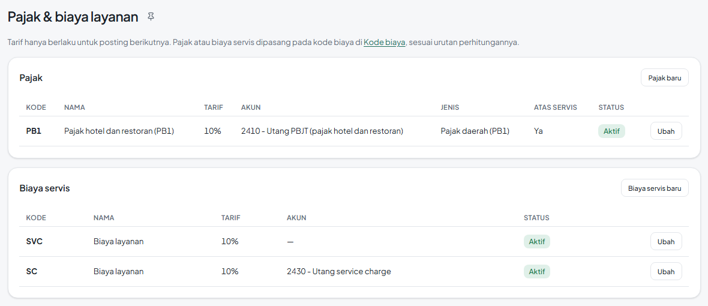
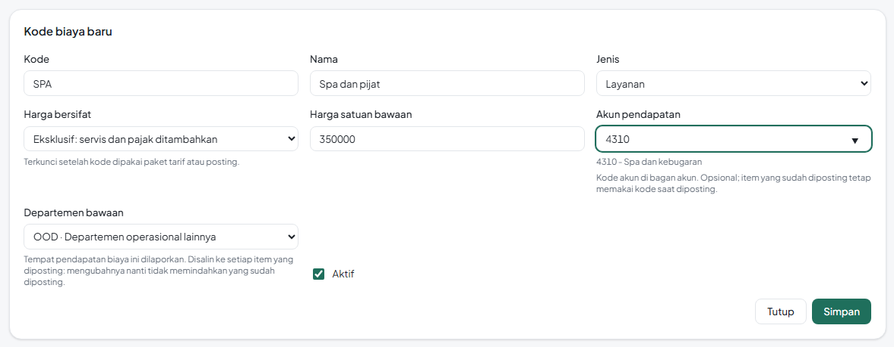
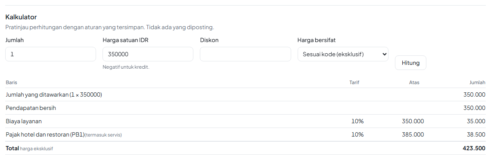

# Pajak dan kode biaya

**Siapa yang melakukan:** administrator hotel, atau staf akuntansi yang perannya boleh mengelola pajak, biaya layanan, dan kode biaya.
**Kapan dilakukan:** saat setup awal, saat tarif pajak daerah atau service charge berubah, dan saat hotel menjual layanan baru (misalnya spa atau antar-jemput bandara).
**Sebelum mulai:**
- Siapkan tarif pajak (misalnya PB1 10%) dan service charge (misalnya 10%), dan kode akun tempat masing-masing dicatat. Tanyakan ke bagian akuntansi.
- Langkah pertama kali (pajak PB1 dan service charge dipasang ke kode **ROOM**) sudah dijelaskan di [Setup awal hotel](../00-memulai/setup-awal-hotel.md). Halaman ini melengkapinya.

**Pajak** dan **biaya servis** hanya berisi tarifnya. Keduanya baru dihitung setelah dipasang pada **kode biaya**. Kode biaya adalah jenis tagihan yang diposting ke folio, misalnya **ROOM**, **RESTAURANT**, atau **LAUNDRY**.

## Langkah-langkah

### Pajak dan biaya servis

1. Buka **Pengaturan → Pajak & biaya layanan**. Ada dua kartu: **Pajak** dan **Biaya servis**, masing-masing dengan **Kode**, **Nama**, **Tarif**, **Akun**, dan **Status**. Kartu **Pajak** juga menunjukkan **Jenis** dan **Atas servis**.

   

   Hotel contoh di gambar punya dua biaya servis bernama "Biaya layanan". Contoh di halaman ini memakai `SC`, yang sudah punya akun.

2. Klik **Pajak baru** atau **Biaya servis baru**, lalu isi formulirnya.

   | Field | Wajib? | Keterangan |
   |---|---|---|
   | Kode | Ya | Misalnya `PB1` atau `SC`. Tidak bisa diubah setelah disimpan. |
   | Nama | Ya | Nama yang tercetak di folio, misalnya `Pajak hotel dan restoran (PB1)`. |
   | Tarif (%) | Ya | `0` sampai `100`, hingga 4 desimal, misalnya `10`. |
   | Akun utang pajak / Akun utang servis | Tidak | Kode akun di bagan akun, misalnya `2410`. Kosong: jumlahnya masuk ke akun utang pajak atau akun utang servis umum. |
   | Jenis pajak | Ya (pajak) | **Pajak daerah (PB1)**, **PPN**, atau **Lainnya**. Hanya **PPN** yang ikut aturan PKP. |
   | Juga dikenakan pada biaya servis | Tidak (pajak) | Centang kalau pajak dihitung dari harga ditambah service charge. Umum untuk PB1. |
   | Aktif | Tidak | Biarkan tercentang. |

3. Klik **Simpan**.
4. **Mengubah tarif**: klik **Ubah** pada barisnya, ubah **Tarif (%)**, lalu klik **Simpan**. Muncul "Tersimpan. {n} tamu menginap akan ditagih dengan tarif baru mulai sekarang.".

### Kode biaya baru

5. Buka **Pengaturan → Kode biaya**, lalu klik **Kode biaya baru**.

   | Field | Wajib? | Keterangan |
   |---|---|---|
   | Kode | Ya | Misalnya `SPA`. Tidak bisa diubah setelah disimpan. |
   | Nama | Ya | Nama yang tercetak di folio dan invoice tamu, misalnya `Spa dan pijat`. |
   | Jenis | Ya | **Kamar**, **Makanan & minuman**, **Layanan**, **Biaya**, atau **Lainnya**. |
   | Harga bersifat | Ya | **Eksklusif: servis dan pajak ditambahkan** (bawaan) atau **Inklusif: servis dan pajak sudah termasuk**. |
   | Harga satuan bawaan | Tidak | Harga yang terisi saat memposting, misalnya `350000`. |
   | Akun pendapatan | Tidak | Kode akun pendapatan, misalnya `4310` (spa dan kebugaran). Kosong: pendapatan masuk ke akun penampungan. |
   | Departemen bawaan | Tergantung akun | Tempat pendapatan dilaporkan, misalnya `OOD`. Disalin ke setiap item yang diposting. |
   | Aktif | Tidak | Biarkan tercentang. |

   

6. Klik **Simpan**. Kode baru muncul di daftar dengan **Aturan (berurutan)** `tidak ada`.

### Memasang pajak dan memeriksa hitungannya

7. Klik **Ubah** pada baris kode itu. Di bagian **Aturan**, pilih biaya servis di **Tambah biaya servis…** lalu klik **Tambah**, pilih pajak di **Tambah pajak…** lalu klik **Tambah**. Atur urutannya dengan **↑** dan **↓**, lalu klik **Simpan aturan**. Muncul "Aturan tersimpan.".
8. Di **Kalkulator** di bawahnya, isi **Jumlah** dan **Harga satuan** (labelnya diikuti kode mata uang, misalnya **Harga satuan IDR**), lalu klik **Hitung**. Tabel menunjukkan **Pendapatan bersih**, setiap biaya servis dan pajak dengan tarif dan dasar hitungnya, dan **Total**. Tidak ada yang diposting.

   

## Hasilnya

- Setiap posting berikutnya dengan kode biaya itu dihitung dengan service charge dan pajak sesuai urutan aturannya. Kolom **Aturan (berurutan)** di daftar menunjukkannya, misalnya `SC 10% → PB1 10%`.
- Tagihan yang sudah diposting tidak ikut berubah.

## Perlu diperhatikan

- **Baris "Jumlah yang ditawarkan"** di kalkulator menampilkan angka tanpa pemisah ribuan, misalnya `1 × 350000`. Angka di tabel hasil sudah berformat biasa.
> ⚠️ Penting: **Harga bersifat** (Eksklusif/Inklusif) terkunci setelah kode dipakai paket tarif atau posting ("Mode harga kode biaya yang sudah dipakai tidak bisa diubah."). **Jenis** kode sistem (bertanda `sistem`) dan kode kamar juga tidak bisa diubah. Pilih dengan benar sejak awal.

- **Tidak ada pilihan "termasuk pajak" pada pajak.** Inklusif atau eksklusif diatur pada kode biaya, bukan pada pajaknya.
- **Pajak, biaya servis, dan kode biaya tidak bisa dihapus.** Hapus centang **Aktif** untuk menghentikannya.
- **"Pajak masih dipetakan ke kode biaya: hapus dulu dari aturannya."**: lepas pajak itu dari bagian **Aturan** setiap kode biaya sebelum menonaktifkannya. Pesan yang sama ada untuk biaya layanan.
- **"Masih ada paket tarif aktif yang menjual lewat kode biaya ini."**: nonaktifkan dulu paket tarif yang memakai kode itu.
- **"Akun ini butuh departemen dan tidak ditemukan: …"**: pilih **Departemen bawaan**.
- **Kode TRF** (Transfer antar folio) tidak punya tombol **Ubah**. Kode ini dipakai sistem untuk pemindahan antar folio.
- **Kode biaya pembulatan POS (`POS_ROUNDING`):**

  > 🐞 Kendala yang diketahui (KD-15): kolom **Jenis** kode ini menampilkan teks mentah `chargeCodes.type_ROUNDING`, dan setiap perubahan pada kode ini gagal disimpan dengan "Ada isian yang tidak valid.". **Dampaknya:** nama, akun, atau departemen kode pembulatan tidak bisa diubah. **Sementara ini:** biarkan kode ini apa adanya. Kalau akunnya perlu diubah, laporkan ke tim KamaraPMS.
- **Tarif berdesimal** tampil dengan titik, misalnya `10.5%` untuk 10,5%.
- **Petunjuk akun** di bawah kolom akun bisa memuat jenis akun dalam bahasa Inggris, misalnya `liability` (kewajiban) atau `revenue` (pendapatan).

## Terkait

- [Setup awal hotel](../00-memulai/setup-awal-hotel.md)
- [Posting biaya ke folio](../03-kasir-dan-pembayaran/posting-biaya-ke-folio.md)
- [Bagan akun dan akun sistem](../07-accounting/bagan-akun-dan-akun-sistem.md)
- [Paket tarif dan grid tarif](paket-tarif-dan-grid-tarif.md)
