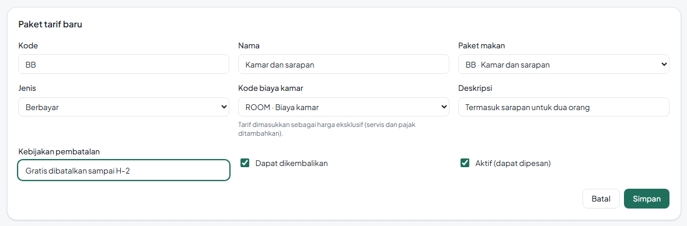
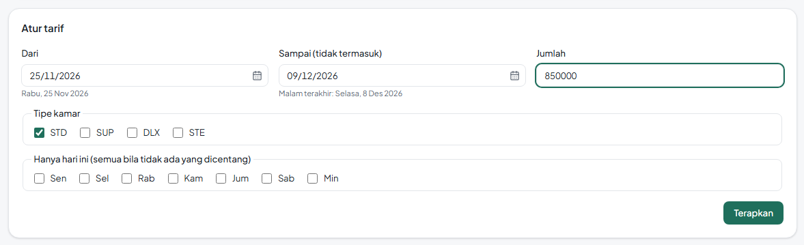
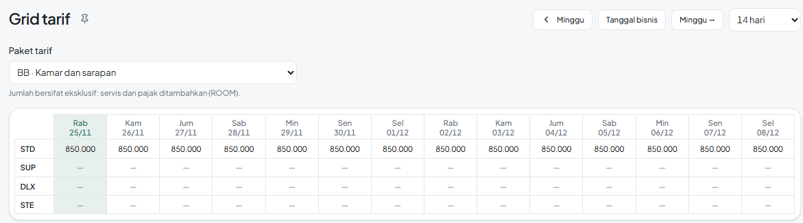

# Paket tarif dan grid tarif

**Siapa yang melakukan:** administrator hotel, revenue manager, atau staf reservasi senior yang perannya boleh mengelola paket tarif dan tarif.
**Kapan dilakukan:**
- **Paket tarif**: saat setup awal, dan saat hotel menjual paket baru (misalnya kamar dengan sarapan).
- **Grid tarif**: saat harga berubah, misalnya untuk musim ramai, akhir pekan, atau acara di sekitar hotel.

**Sebelum mulai:**
- Tipe kamar sudah dibuat. Lihat [Tipe kamar dan kamar](tipe-kamar-dan-kamar.md).
- Kode biaya kamar **ROOM** sudah dipasangi service charge dan pajak. Lihat [Pajak dan kode biaya](pajak-dan-kode-biaya.md).
- Siapkan daftar harga per tipe kamar per malam.

**Paket tarif** menentukan apa yang dijual (misalnya kamar saja, atau kamar dan sarapan) dan lewat kode biaya mana. **Grid tarif** berisi harganya: satu angka untuk setiap tipe kamar dan setiap malam.

## Langkah-langkah

### Membuat paket tarif

1. Buka **Pengaturan → Paket tarif**, lalu klik **Paket tarif baru**.
2. Isi formulirnya.

   | Field | Wajib? | Keterangan |
   |---|---|---|
   | Kode | Ya | Misalnya `BB`. Tidak bisa diubah setelah disimpan. |
   | Nama | Ya | Nama yang dilihat resepsionis, misalnya `Kamar dan sarapan`. |
   | Paket makan | Ya | **RO · Hanya kamar**, **BB · Kamar dan sarapan**, **HB · Setengah pensiun**, **FB · Pensiun penuh**, atau **AI · Semua termasuk**. |
   | Jenis | Ya | **Berbayar** untuk paket biasa. **Komplimen** dan **Pemakaian hotel** untuk kamar gratis: tanpa harga, dan memesannya butuh alasan dan izin. Tidak bisa diubah setelah disimpan. |
   | Kode biaya kamar | Ya | Biasanya `ROOM · …`. Kalimat di bawahnya menyebut apakah harga di grid inklusif atau eksklusif pajak dan servis. |
   | Deskripsi | Tidak | Misalnya `Termasuk sarapan untuk dua orang`. |
   | Kebijakan pembatalan | Tidak | Misalnya `Gratis dibatalkan sampai H-2`. |
   | Dapat dikembalikan | Tidak | Bawaan tercentang. Hapus centang untuk harga non-refundable. |
   | Aktif (dapat dipesan) | Tidak | Biarkan tercentang. |

   

3. Klik **Simpan**. Paket baru muncul di daftar. Paket ini belum bisa dijual sebelum punya harga di grid.
4. **Plan acuan**: buka lagi sebuah paket **Berbayar** dengan **Ubah**, lalu centang **Plan acuan**. Harga grid paket ini dipakai untuk menilai kamar komplimen dan pemakaian hotel di laporan. Satu properti hanya punya satu paket acuan, bertanda **Acuan** di daftar.

### Mengisi grid tarif

5. Buka **Pengaturan → Grid tarif**, lalu pilih **Paket tarif**. Grid menunjukkan harga tiap tipe kamar per malam mulai tanggal bisnis. Tanda **—** berarti malam itu belum punya harga. Geser dengan **← Minggu** dan **Minggu →**, atau pilih **14 hari** / **28 hari**.
6. Di kartu **Atur tarif**, isi rentang dan harganya. Mengklik satu sel di grid langsung mengisi kartu ini untuk tipe dan malam itu.

   | Field | Wajib? | Keterangan |
   |---|---|---|
   | Dari | Ya | Malam pertama. |
   | Sampai (tidak termasuk) | Ya | Malam setelah malam terakhir. Untuk 1–14 Desember, isi 15 Desember. Paling panjang 730 hari. |
   | Jumlah | Ya | Harga per malam, misalnya `850000`. |
   | Tipe kamar | Ya | Centang tipe yang diberi harga ini. |
   | Hanya hari ini | Tidak | Centang hari tertentu, misalnya hanya Jumat dan Sabtu untuk harga akhir pekan. Kosong berarti semua hari. |

   

7. Klik **Terapkan**. Muncul "{n} malam ditulis, {m} di antaranya baru.", dan grid menampilkan harga baru.

   

### Selisih harga bed

8. Kalau tempat tidur tertentu dijual lebih mahal atau lebih murah, buka **Pengaturan → Selisih harga bed**, pilih **Paket tarif**, lalu klik **Selisih baru**. Isi **Tipe kamar**, **Bed**, **Jenis** (**Nominal** atau **Persen**), **Nilai** (negatif untuk diskon), dan **Mulai**, lalu klik **Simpan**. Selisih ini hanya berlaku untuk reservasi yang mengunci tempat tidur itu.

## Hasilnya

- Paket yang aktif dan punya harga muncul di pencarian **Reservasi baru**. Lihat [Membuat reservasi](../01-front-desk/membuat-reservasi.md).
- Harga baru hanya berlaku untuk pemesanan berikutnya. Reservasi yang sudah ada tetap memakai harga saat dipesan.

## Perlu diperhatikan

> ⚠️ Penting: **Jenis** paket tarif tidak bisa diubah setelah disimpan, dan baris **Selisih harga bed** tidak bisa diubah atau dihapus. Untuk mengganti selisih, tambahkan baris baru yang mulai pada tanggal berikutnya.

- **Paket tarif tidak bisa dihapus.** Hapus centang **Aktif (dapat dipesan)** untuk berhenti menjualnya.
- **Tombol Paket tarif baru** tidak bisa diklik kalau belum ada kode biaya bertipe Kamar yang aktif.
- **"Plan ini sudah punya tarif dengan mode harga yang berbeda dari kode biaya baru. Buat plan baru."**: kode biaya kamar baru inklusif sementara yang lama eksklusif (atau sebaliknya). Buat paket baru untuk mode harga yang lain.
- **"Properti ini sudah punya paket tarif acuan."**: hapus dulu centang **Plan acuan** pada paket yang lama.
- **"Tidak ada hari yang dipilih yang jatuh dalam rentang."**: hari yang dicentang tidak ada di antara **Dari** dan **Sampai**.
- **Paket Komplimen dan Pemakaian hotel** tidak muncul di grid tarif karena memang gratis. Batas bulanannya diatur di [Kuota malam gratis](pembatasan-yield-dan-kuota.md).
- **Kalimat di bawah Jenis** untuk paket gratis menyebut izin `reservation.komplimen` (izin memesan kamar komplimen). Nama izin yang benar di halaman **Peran** adalah "Memesan kamar komplimen dan pemakaian hotel".
- **Tanggal di grid** tampil sebagai hari dan `dd/mm`, misalnya `Sen 01/12`.
- **Di daftar Selisih harga bed**, tanggal **Mulai** tampil seperti `2026-12-01` dan nilai selisih tanpa pemisah ribuan, misalnya `+150000`.

## Terkait

- [Pembatasan, aturan yield, dan kuota](pembatasan-yield-dan-kuota.md)
- [Tipe kamar dan kamar](tipe-kamar-dan-kamar.md)
- [Membuat reservasi](../01-front-desk/membuat-reservasi.md)
