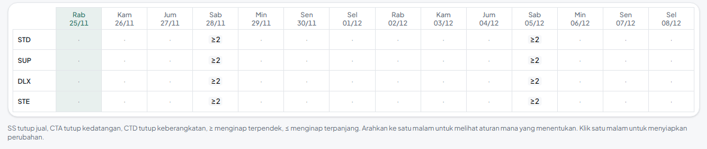
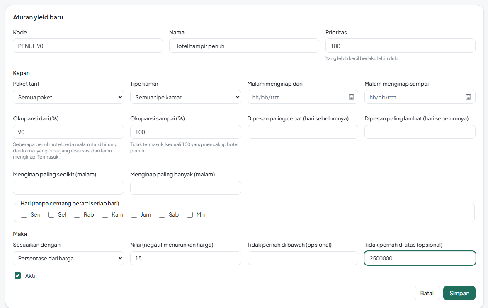
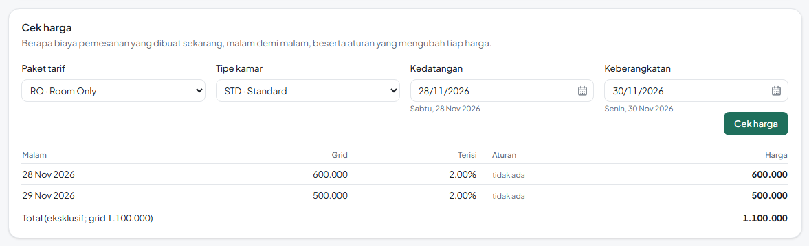

# Pembatasan penjualan, aturan yield, dan kuota malam gratis

**Siapa yang melakukan:** revenue manager atau manajer front office yang perannya boleh mengelola paket tarif dan tarif.
**Kapan dilakukan:**
- **Pembatasan penjualan**: menjelang tanggal ramai, misalnya minimal menginap dua malam di akhir pekan atau tutup jual saat ada acara besar.
- **Aturan yield**: saat hotel ingin harga naik atau turun otomatis menurut keterisian atau jarak pemesanan.
- **Kuota malam gratis**: sekali, lalu setiap kali kebijakan kamar komplimen berubah.

**Sebelum mulai:** paket tarif dan grid tarif sudah terisi. Lihat [Paket tarif dan grid tarif](paket-tarif-dan-grid-tarif.md).

## Langkah-langkah

### Pembatasan penjualan

1. Buka **Pengaturan → Pembatasan penjualan**, lalu pilih **Paket tarif**. Grid menunjukkan pembatasan tiap tipe kamar per malam. Tanda di sel: **SS** tutup jual, **CTA** tutup kedatangan, **CTD** tutup keberangkatan, **≥2** menginap terpendek 2 malam, **≤7** menginap terpanjang 7 malam. Arahkan tetikus ke sebuah malam untuk melihat aturan mana yang menentukannya.
2. Di kartu **Atur pembatasan**, isi rentang dan apa yang diatur.

   | Field | Wajib? | Keterangan |
   |---|---|---|
   | Mulai / Sampai (tidak termasuk) | Ya | Rentang malam, paling panjang 366 hari. |
   | Tipe kamar | Tidak | Tanpa centang berarti semua tipe kamar. |
   | Paket tarif | Tidak | Tanpa centang berarti semua paket tarif. |
   | Hanya hari ini | Tidak | Misalnya hanya **Sab**. Kosong berarti setiap hari. |
   | Tutup jual / Tutup kedatangan / Tutup keberangkatan | Tidak | **Tidak diubah**, **Tutup**, **Buka**, atau **Hapus**. **Buka** mengalahkan aturan lebih luas yang menutup. |
   | Menginap terpendek (malam) / Menginap terpanjang (malam) | Tidak | Untuk menginap yang datang pada tanggal itu, misalnya `2`. Centang **Hapus** di bawahnya untuk menghapus angka yang ada. |
   | Catatan | Tidak | Alasannya, misalnya `Akhir pekan minimal 2 malam`. |

3. Klik **Terapkan**. Muncul "{a} ditambah, {b} diubah, {c} dihapus.", dan grid menampilkan tandanya.

   

### Aturan yield

4. Buka **Pengaturan → Aturan yield**, lalu klik **Aturan baru**.
5. Isi formulirnya. Bagian **Kapan** berisi syaratnya; semua syarat yang diisi harus terpenuhi. Bagian **Maka** berisi perubahan harganya.

   | Field | Wajib? | Keterangan |
   |---|---|---|
   | Kode / Nama | Ya | Misalnya `PENUH90` dan `Hotel hampir penuh`. Kode tidak bisa diubah. |
   | Prioritas | Ya | Bawaan `100`. Yang lebih kecil berlaku lebih dulu. |
   | Paket tarif / Tipe kamar | Tidak | **Semua paket** / **Semua tipe kamar**, atau satu saja. |
   | Malam menginap dari / sampai | Tidak | Batasi aturan ke tanggal tertentu. |
   | Okupansi dari (%) / sampai (%) | Tidak | Seberapa penuh hotel pada malam itu, misalnya `90` sampai `100`. "Dari" termasuk; "sampai" tidak termasuk, kecuali `100`. |
   | Dipesan paling cepat / paling lambat (hari sebelumnya) | Tidak | Misalnya `0` sampai `2` untuk pemesanan mendadak. |
   | Menginap paling sedikit / paling banyak (malam) | Tidak | Misalnya `7` untuk menginap panjang. |
   | Hari | Tidak | Tanpa centang berarti setiap hari. |
   | Sesuaikan dengan | Ya | **Persentase dari harga** atau **Sejumlah nominal**. |
   | Nilai (negatif menurunkan harga) | Ya | Misalnya `15` untuk naik 15%, atau `-10` untuk turun 10%. Tidak boleh nol. |
   | Tidak pernah di bawah / di atas | Tidak | Batas harga terendah dan tertinggi setelah aturan. |
   | Aktif | Tidak | Biarkan tercentang. |

   

6. Klik **Simpan**. Aturan muncul di daftar dengan tombol **Ubah**, **Matikan** / **Nyalakan**, dan **Hapus**.
7. Periksa hasilnya di kartu **Cek harga**: pilih **Paket tarif**, **Tipe kamar**, **Kedatangan**, dan **Keberangkatan**, lalu klik **Cek harga**. Tabel menunjukkan tiap malam dengan harga **Grid**, keterisian (**Terisi**), **Aturan** yang mengubahnya, dan **Harga** akhirnya.

   

### Kuota malam gratis

8. Buka **Pengaturan → Kuota malam gratis**. Di kartu **Komplimen** dan **Pemakaian hotel**, isi **Malam per bulan**, misalnya `10`, lalu klik **Simpan**. Kosongkan kolomnya untuk tanpa batas. Muncul misalnya "Komplimen: batas 10 malam per bulan disimpan.".

## Hasilnya

- **Pembatasan**: pemesanan baru yang melanggarnya ditolak, kecuali pemegang izin melewatinya dengan alasan dan persetujuan. Reservasi yang sudah ada tidak berubah.
- **Aturan yield**: harga jual tiap malam dihitung dari harga grid, lalu diubah oleh aturan yang cocok sesuai prioritas. Pemesanan menyimpan harga saat dijual.
- **Kuota**: pemesanan kamar komplimen atau pemakaian hotel yang melewati batas bulanan butuh persetujuan manajer. Kuota menghitung kamar terkonfirmasi, check-in, dan selesai.

## Perlu diperhatikan

- **Kolom Terisi** di cek harga tampil dengan titik desimal, misalnya `2.00%` (artinya 2%).
> ⚠️ Penting: **Hapus** pada aturan yield benar-benar menghapus aturannya ("Hapus aturan {kode}?"). Pemesanan yang sudah dibuat tetap memakai harganya. Untuk berhenti sementara, pakai **Matikan**.

- **Melewati pembatasan** saat memesan butuh persetujuan. Siapa yang boleh menyetujui diatur di [Aturan persetujuan](aturan-persetujuan.md), baris **Melewati batasan penjualan**.
- **"Tanggal ini sudah punya pembatasan untuk tipe kamar dan paket tarif ini."**: muat ulang halaman, lalu ubah pembatasan yang ada lewat kartu **Atur pembatasan**.
- **Kalau tidak ada yang dipilih untuk diubah**, di atas tombol **Terapkan** muncul tulisan berbahasa Inggris `set or clear at least one attribute` (atur atau hapus minimal satu hal).
- **Daftar aturan yield** menampilkan tanggal seperti `2026-12-24` dan nominal tanpa pemisah ribuan, misalnya `+50000`. Batas harga tampil seperti `(500000 to 2000000)`, dengan kata Inggris `to` (sampai).
- **Tanggal di grid pembatasan** tampil sebagai hari dan `dd/mm`.

## Terkait

- [Paket tarif dan grid tarif](paket-tarif-dan-grid-tarif.md)
- [Aturan persetujuan](aturan-persetujuan.md)
- [Membuat reservasi](../01-front-desk/membuat-reservasi.md)
