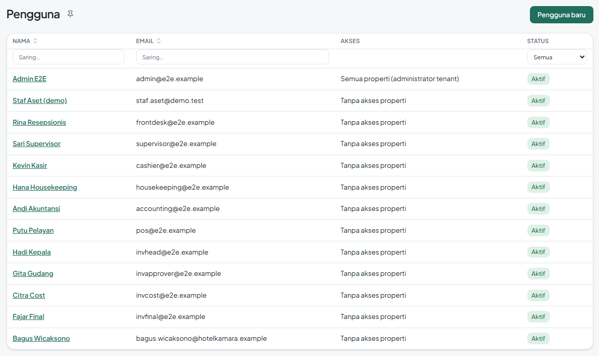
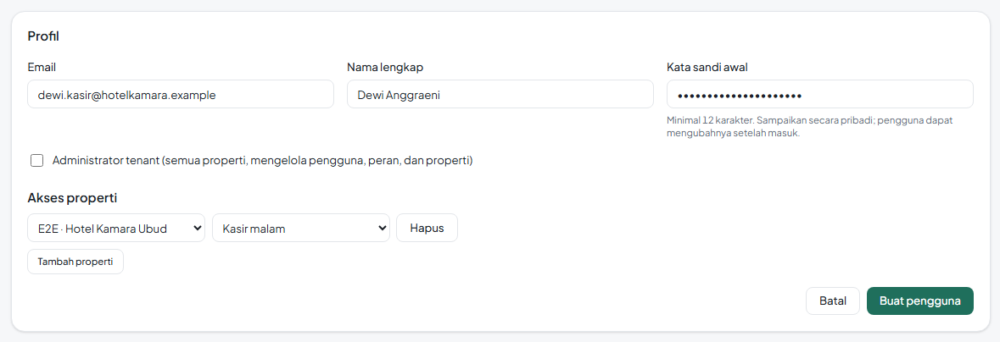
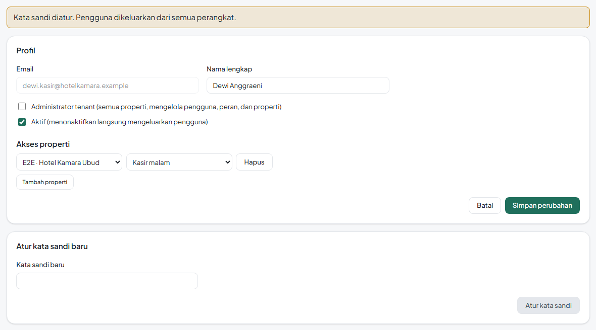

# Pengguna

**Siapa yang melakukan:** administrator hotel (pengguna dengan centang **Administrator tenant**).
**Kapan dilakukan:** saat ada staf baru, saat staf pindah tugas atau mulai bekerja di hotel lain, saat staf lupa kata sandi, dan saat staf berhenti.
**Sebelum mulai:**
- Peran untuk jabatannya sudah ada di **Pengaturan → Peran**. Lihat [Peran](peran.md).
- Siapkan nama lengkap dan alamat email kerja staf. Email inilah yang dipakai untuk masuk.

Setiap pengguna mendapat **satu peran untuk setiap properti** tempat ia bekerja. Penjelasan peran dan izin ada di [Peran dan hak akses](../00-memulai/peran-dan-hak-akses.md).

## Langkah-langkah

### Membuat pengguna

1. Buka **Pengaturan → Pengguna**. Kolom **Akses** menunjukkan hak masing-masing: "Semua properti (administrator tenant)", "Tanpa akses properti", atau kode properti dengan perannya.

   

   "Tanpa akses properti" berarti pengguna itu memang belum punya peran di properti mana pun, sehingga ia tidak bisa membuka properti apa pun setelah masuk.

2. Klik **Pengguna baru**, lalu isi kartu **Profil**.

   | Field | Wajib? | Keterangan |
   |---|---|---|
   | Email | Ya | Email kerja, misalnya `dewi.kasir@hotelkamara.example`. Tidak bisa diubah setelah disimpan. |
   | Nama lengkap | Ya | Misalnya `Dewi Anggraeni`. Tampil di jejak audit dan di dokumen. |
   | Kata sandi awal | Ya | Minimal 12 karakter. Sampaikan secara pribadi, bukan lewat grup obrolan. |
   | Administrator tenant | Tidak | Centang hanya untuk pengelola sistem. Administrator boleh melakukan semuanya di semua properti, termasuk mengelola pengguna, peran, dan properti. |

3. Di bagian **Akses properti**, klik **Tambah properti**. Pilih properti di kolom **Properti…** dan perannya di kolom **Peran…**. Untuk staf yang bekerja di beberapa hotel, klik **Tambah properti** lagi untuk setiap hotel. Klik **Hapus** untuk membuang sebuah baris.

   

4. Klik **Buat pengguna**. Anda kembali ke daftar, dan pengguna baru muncul di sana.

### Mengganti peran atau menonaktifkan pengguna

5. Di daftar **Pengguna**, klik nama pengguna.
6. Ubah yang perlu, lalu klik **Simpan perubahan**:
   - **Mengganti peran**: pilih peran lain di baris properti itu.
   - **Memberi akses ke hotel lain**: klik **Tambah properti**, lalu pilih properti dan perannya.
   - **Mencabut akses ke satu hotel**: klik **Hapus** pada baris properti itu.
   - **Staf berhenti**: hapus centang **Aktif (menonaktifkan langsung mengeluarkan pengguna)**.

### Mengatur kata sandi baru

7. Kalau staf lupa kata sandi, buka halaman pengguna itu. Di kartu **Atur kata sandi baru**, ketik kata sandi baru (minimal 12 karakter), lalu klik **Atur kata sandi**. Muncul "Kata sandi diatur. Pengguna dikeluarkan dari semua perangkat.".

   

## Hasilnya

- Pengguna masuk dengan **kode tenant**, emailnya, dan kata sandi awal. Ia hanya melihat properti yang diberikan, dan di tiap properti hanya menu yang diizinkan perannya.
- Perubahan peran berlaku pada permintaan berikutnya, tanpa perlu keluar dan masuk lagi.
- Pengguna yang dinonaktifkan langsung keluar dari semua perangkat dan tidak bisa masuk lagi.

## Perlu diperhatikan

> ⚠️ Penting: pengguna tidak bisa dihapus, dan emailnya tidak bisa diubah. Kalau email salah ketik, nonaktifkan pengguna itu lalu buat yang baru dengan email yang benar.

- **Minta staf mengganti kata sandi awal** setelah masuk pertama kali. Lihat [Mengubah kata sandi](../00-memulai/mengubah-kata-sandi.md).
- **Baris akses yang belum lengkap** tidak disimpan diam-diam. Kalau properti atau peran sebuah baris belum dipilih, tidak ada yang disimpan, dan di bawah baris itu muncul "Pilih properti dan peran untuk baris ini, atau hapus barisnya.". Lengkapi barisnya atau klik **Hapus**, lalu simpan lagi. Untuk administrator tenant, baris akses tidak diperiksa, karena ia sudah mengakses semua properti.
- **Satu peran per properti.** "Satu pengguna hanya boleh punya satu peran per properti." berarti properti yang sama dipilih dua kali. Gabungkan izinnya dalam satu peran.
- **"Tenant harus punya setidaknya satu administrator aktif."**: Anda mencoba menonaktifkan atau mencabut centang administrator terakhir. Jadikan orang lain administrator dulu.
- **"Pengguna adalah kepala atau wakil sebuah departemen: …"**: pilih kepala atau wakil lain di [Departemen](../07-accounting/departemen.md) sebelum menonaktifkan pengguna itu.
- **"Batas paket tercapai: …"**: jumlah pengguna aktif sudah mencapai batas langganan. Nonaktifkan pengguna yang sudah tidak bekerja, atau lihat [Langganan dan sistem](langganan-dan-sistem.md).
- **Kata sandi kurang dari 12 karakter** ditolak dengan pesan berbahasa Inggris `at least 12 characters` (minimal 12 karakter).
- **Tombol Atur kata sandi** baru bisa diklik setelah kata sandi minimal 12 karakter.
- **Kalau Simpan perubahan gagal** setelah Anda mengubah nama dan akses sekaligus, sebagian perubahan mungkin sudah tersimpan. Buka lagi halaman pengguna itu dan periksa isinya sebelum mencoba lagi.
- **Verifikasi dua langkah** (kode dari ponsel) belum tersedia untuk staf hotel.

## Terkait

- [Peran](peran.md)
- [Peran dan hak akses](../00-memulai/peran-dan-hak-akses.md)
- [Mengubah kata sandi](../00-memulai/mengubah-kata-sandi.md)
