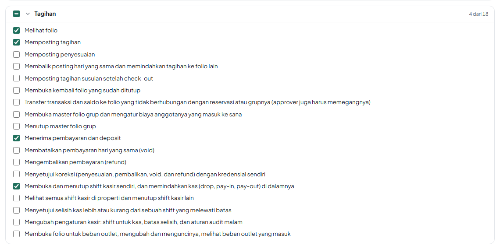
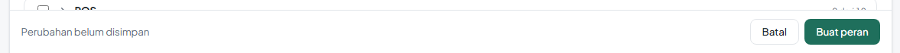
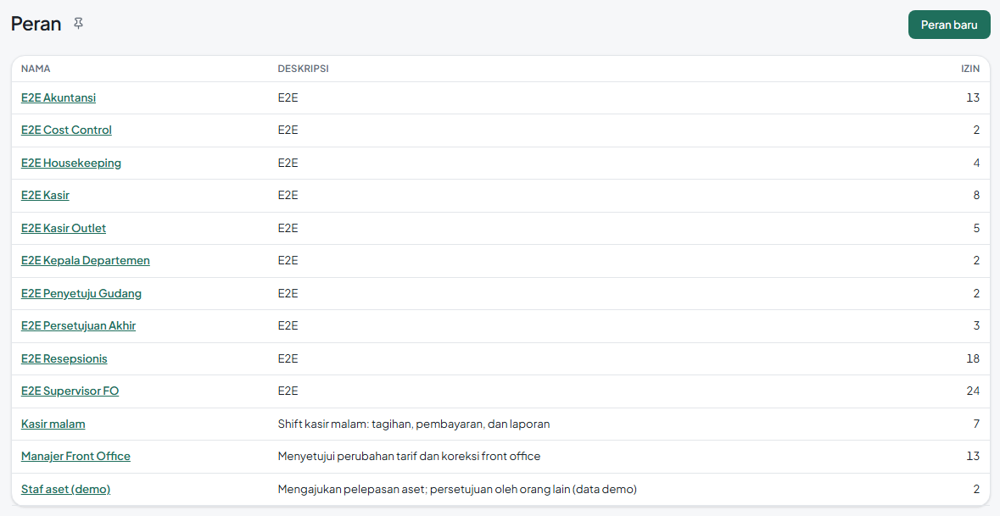

# Peran

**Siapa yang melakukan:** administrator hotel (pengguna dengan centang **Administrator tenant**).
**Kapan dilakukan:** saat setup awal, saat ada jabatan baru, dan saat tugas sebuah jabatan berubah.
**Sebelum mulai:** daftar jabatan di hotel Anda dan kegiatan yang boleh dilakukan tiap jabatan. Contoh peran dan izin yang disarankan ada di [Peran dan hak akses](../00-memulai/peran-dan-hak-akses.md).

**Peran** adalah kumpulan izin yang diberi nama. KamaraPMS tidak menyediakan peran siap pakai: daftar **Peran** pada hotel baru masih kosong ("Belum ada peran."). Peran berlaku di semua properti perusahaan; di halaman [Pengguna](pengguna.md) Anda memilih peran mana yang dipegang seseorang di tiap properti.

## Langkah-langkah

### Membuat peran

1. Buka **Pengaturan → Peran**. Daftar menampilkan **Nama**, **Deskripsi**, dan jumlah **Izin** tiap peran.
2. Klik **Peran baru**, lalu isi **Nama** dan **Deskripsi**.

   | Field | Wajib? | Keterangan |
   |---|---|---|
   | Nama | Ya | Nama jabatan, misalnya `Kasir malam`. Tidak boleh sama dengan peran lain. |
   | Deskripsi | Tidak | Misalnya `Shift kasir malam: tagihan, pembayaran, dan laporan`. |

3. Di bagian **Izin**, klik nama sebuah kelompok untuk membukanya, lalu centang izin yang diperlukan. Centang di samping nama kelompok memilih atau mengosongkan semua izin kelompok itu. Angka di kanan, misalnya **4 dari 18**, menunjukkan berapa yang dicentang.

   

4. Begitu ada perubahan, bilah "Perubahan belum disimpan" muncul di bawah layar. Klik **Buat peran**.

   

5. Anda kembali ke daftar **Peran**. Peran baru muncul dengan jumlah izinnya. Berikan peran itu kepada staf di [Pengguna](pengguna.md).

   

### Mengubah peran

6. Klik nama peran di daftar. Judul halaman menjadi **Peran: {nama}**, dan kelompok yang berisi izin terpilih sudah terbuka.
7. Centang atau hapus centang izin, lalu klik **Simpan perubahan** di bilah bawah. Klik **Batal** untuk membuang perubahan.

## Hasilnya

- Pemegang peran hanya melihat menu dan tombol yang diizinkan.
- Perubahan pada peran berlaku bagi semua pemegangnya pada permintaan berikutnya, tanpa perlu keluar dan masuk lagi.

## Perlu diperhatikan

- **Peran tidak bisa dihapus.** Peran yang tidak dipakai lagi bisa dibiarkan; cabut dari semua pengguna di halaman [Pengguna](pengguna.md).
- **Meninggalkan halaman sebelum menyimpan** memunculkan pertanyaan "Keluar tanpa menyimpan?". Klik **Keluar** untuk membuang perubahan, atau **Lanjut mengubah**. Tombol **Batal** di bilah bawah juga memunculkan pertanyaan ini.
- **"Nama ini sudah dipakai."**: sudah ada peran dengan nama yang sama.
- **Izin "Menyetujui …"** sebaiknya hanya diberikan kepada atasan. Siapa yang boleh menyetujui miliknya sendiri diatur di [Aturan persetujuan](aturan-persetujuan.md).
- **Izin "Mengelola paket tarif dan tarif"** membuka semua halaman tarif: paket tarif, grid tarif, selisih harga bed, pembatasan penjualan, aturan yield, dan kuota malam gratis.
- **Izin "Mengelola pajak, biaya layanan, dan kode tagihan"** membuka halaman **Pajak & biaya layanan** dan **Kode biaya** (di menu disebut "kode biaya").
- **Menu Properti, Pengguna, Peran, Sistem, dan Langganan** hanya terbuka untuk administrator tenant. Tidak ada izin untuk membukanya dari sebuah peran.
- **Bagian yang masih berbahasa Inggris** di layar: kelompok **Inventory** (persediaan), **Banquet** (acara), dan **Fixed assets** (aset tetap), serta sebagian besar izin di dalamnya. Artinya ada di tabel di bawah.

## Daftar izin

Urutan dan nama kelompok seperti di layar.

| Kelompok | Izin |
|---|---|
| **Properti** | Mengubah pengaturan properti |
| **Kamar** | Mengelola tipe kamar dan kamar · Membuat dan melepas blokir kamar (rusak / tidak dipakai) · Mengubah status kebersihan kamar · Menandai kamar sudah diperiksa (supervisor) · Membuat daftar pembersihan harian dan menugaskannya ke petugas kebersihan · Melaporkan masalah perawatan dan melihat permintaannya · Menugaskan, mengerjakan, menyelesaikan dan membatalkan permintaan perawatan, serta menutup kamar dari penjualan · Mencatat barang temuan dan melihat daftar barang temuan · Mengubah data barang, mengembalikannya ke pemilik, dan memusnahkannya |
| **Akuntansi** | Melihat bagan akun, jurnal, buku besar dan laporan keuangan · Mengubah bagan akun dan akun yang dipakai sistem untuk memposting · Memposting jurnal manual dan membalik jurnal (pembalikan perlu persetujuan) · Menutup dan membuka kembali periode akuntansi, dan memposting jurnal tutup hari yang terlewat |
| **Utang usaha** | Melihat pemasok, tagihan pemasok, pembayaran, dan umur utang · Menambah dan mengubah pemasok · Memasukkan tagihan dan pembayaran pemasok; membatalkannya perlu persetujuan |
| **Bank** | Melihat rekening bank, mutasi, dan rekonsiliasinya · Memilih akun buku mana yang direkonsiliasi dengan bank · Mengimpor mutasi bank, mencocokkannya dengan buku, memposting selisih yang hanya terlihat di bank, dan merekonsiliasi; membuka kembali perlu persetujuan |
| **Pajak** | Melihat lembar kerja pajak, SPT yang sudah dilaporkan, pembayaran pajak, dan kewajiban kepada otoritas pajak · Mengatur cara tiap pajak dilaporkan: otoritas, nomor pendaftaran, dan tanggal jatuh tempo · Melaporkan SPT bulanan dan mencatat pembayaran ke otoritas pajak; membatalkannya perlu persetujuan · Menerbitkan faktur pajak untuk invoice piutang perusahaan dan folio, mencatat nomor resminya, mengekspor, dan membatalkannya (perlu persetujuan) |
| **Anggaran** | Melihat anggaran dan laporan anggaran terhadap realisasi · Membuat dan mengubah draf anggaran, mengimpor dan menyalinnya, dan mengaktifkan satu versi (perlu persetujuan) · Menyetujui pengaktifan versi anggaran, sebagai orang kedua |
| **Tamu** | Melihat profil tamu · Membuat dan mengubah profil tamu · Mencari profil tamu di seluruh penyewa · Melihat riwayat tamu di properti lain |
| **Konfigurasi** | Mengelola pajak, biaya layanan, dan kode tagihan · Mengelola paket tarif dan tarif |
| **Reservasi** | Melihat reservasi dan ketersediaan · Membuat dan mengonfirmasi reservasi · Mengubah reservasi dan menetapkan kamar · Membatalkan reservasi · Memulihkan reservasi yang dibatalkan · Membatalkan kamar satu grup sekaligus, dan memulihkannya · Mengubah tarif per malam secara manual · Menetapkan kamar yang lebih tinggi (naik kelas) · Memesan kamar komplimen dan pemakaian hotel · Menyetujui perubahan tarif per malam (…) · Menyetujui kamar komplimen dan pemakaian hotel, dan melewati kuota malam gratis bulanan · Menjual menginap yang melanggar pembatasan penjualan (…), dengan alasan dan persetujuan · Menyetujui penjualan menginap yang melanggar pembatasan penjualan (…) |
| **Front Desk** | Check-in tamu (termasuk walk-in) · Check-in ke kamar yang belum bersih atau diperiksa · Check-out tamu · Memindahkan tamu antar kamar · Mengubah tarif tamu yang sedang menginap · Membatalkan check-in pada hari bisnis yang sama |
| **Tagihan** | Melihat folio · Memposting tagihan · Memposting penyesuaian · Membalik posting hari yang sama dan memindahkan tagihan ke folio lain · Memposting tagihan susulan setelah check-out · Membuka kembali folio yang sudah ditutup · Transfer transaksi dan saldo ke folio yang tidak berhubungan dengan reservasi atau grupnya (…) · Membuka master folio grup dan mengatur biaya anggotanya yang masuk ke sana · Menutup master folio grup · Menerima pembayaran dan deposit · Membatalkan pembayaran hari yang sama (void) · Mengembalikan pembayaran (refund) · Menyetujui koreksi (penyesuaian, pembalikan, void, dan refund) dengan kredensial sendiri · Membuka dan menutup shift kasir sendiri, dan memindahkan kas (drop, pay-in, pay-out) di dalamnya · Melihat semua shift kasir di properti dan menutup shift kasir lain · Menyetujui selisih kas lebih atau kurang dari sebuah shift yang melewati batas · Mengubah pengaturan kasir: shift untuk kas, batas selisih, dan aturan audit malam · Membuka folio untuk beban outlet, mengubah dan menguncinya, melihat beban outlet yang masuk |
| **Akhir hari** | Menjalankan audit malam dan memposting biaya kamar · Menandai kedatangan sebagai tidak datang · Membangun ulang paket audit malam dan mengatur penerimanya lewat e-mail · Melihat arsip paket audit malam · Mengirim ulang paket audit malam lewat e-mail |
| **Laporan** | Melihat dan mengekspor laporan |
| **Akun perusahaan** | Membuat dan mengubah perusahaan (akun korporat) dan ketentuan kreditnya · Membuat dan mengubah pemesanan grup dan menambahkan kamarnya · Melihat akun piutang perusahaan, rekening koran, dan umur piutangnya · Memindahkan saldo folio tamu ke akun piutang perusahaan · Mencatat dan membatalkan pembayaran perusahaan terhadap akunnya · Menerbitkan dan membatalkan invoice ke perusahaan untuk pemindahan yang sudah check-out · Membuat dan membatalkan nota kredit ke perusahaan (…) · Mencatat pengingat pembayaran … dan mengatur denda yang tertera · Menghapus sisa tagihan sebuah invoice perusahaan, dan membatalkan penghapusan (perlu persetujuan) |
| **POS** | Mengatur outlet: produk, harga, profil, denah, stasiun, dan printer · Mengambil pesanan: membuka bill, menambah item, mengirim ke dapur atau bar · Menerima pembayaran, menutup, memisah, dan menggabung bill, mencetak struk, membuka laci · Membebankan bill outlet ke kamar · Memberi diskon di outlet · Menjadikan bill atau item outlet komplimen · Membatalkan (void) item yang sudah dikirim ke dapur atau bar · Menyetujui void, diskon, komplimen, atau pembukaan ulang bill outlet · Memakai layar dapur · Melihat laporan outlet |
| **Inventory** (persediaan) | Melihat barang, gudang, stok, kartu stok, dan saldo awal · Mengatur persediaan: metode harga pokok, satuan, kategori dan akun, barang, gudang, dan level minimum · Memposting saldo awal gudang · "Transfer goods between warehouses, issue goods to a department, record waste, staff meals and entertainment" (mutasi antar gudang, pengeluaran ke departemen, barang rusak, makan staf, jamuan) · "Start, enter and submit a stock count of a warehouse" (opname stok) · "Write, submit and recall purchase requests" (permintaan pembelian) · "Write, send, cancel and close purchase orders" (pesanan pembelian) · "Receive goods against an order or without one, …" (penerimaan barang dan retur ke pemasok) · "Confirm the draft bills of the receipts against the supplier's invoice …" (mencocokkan tagihan pemasok; juga butuh izin memasukkan tagihan pemasok) · "Approve a price difference on a supplier bill above the tolerance, as the second person" (menyetujui selisih harga tagihan) · "Approve the first level of a request as the head or the deputy of its department" (persetujuan kepala departemen) · "Approve the level of a request that is given to cost control" (persetujuan cost control) · "Approve the final level of a request (financial controller, general manager)" (persetujuan akhir permintaan) · "Approve the final level of a store requisition (store manager, financial controller)" (persetujuan akhir permintaan gudang) |
| **Banquet** (acara) | "See the calendar of the meeting rooms, the events and their sessions" (melihat kalender ruang dan acara) · "Create and change events (inquiry and tentative), …" (membuat dan mengubah acara) · "Confirm an event (definite) and cancel a definite event" (mengonfirmasi dan membatalkan acara pasti) · "Set up the meeting rooms, … and the banquet settings" (menyiapkan ruang, item, paket, dan pengaturan banquet) |
| **Fixed assets** (aset tetap) | "See the asset register, its schedules and reports, the waiting list and the labels" (melihat register aset) · "Make assets from journal lines, change the details of an asset, move assets, …" (membuat, mengubah, memindahkan, dan mengopname aset) · "Run and reverse the depreciation of a month" (menjalankan penyusutan) · "Sell or write off an asset and reverse a disposal; approve a disposal as the second person" (melepas aset dan menyetujuinya) · "Set up the asset categories and their accounts, …" (menyiapkan kategori, lokasi, pengaturan, dan saldo awal aset) |
| **Administrasi** | Membaca jejak audit |

Tanda (…) berarti kalimat di layar lebih panjang dan dipendekkan di tabel ini.

## Terkait

- [Peran dan hak akses](../00-memulai/peran-dan-hak-akses.md)
- [Pengguna](pengguna.md)
- [Aturan persetujuan](aturan-persetujuan.md)
