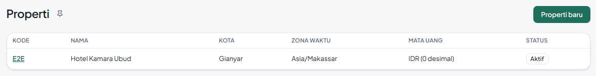
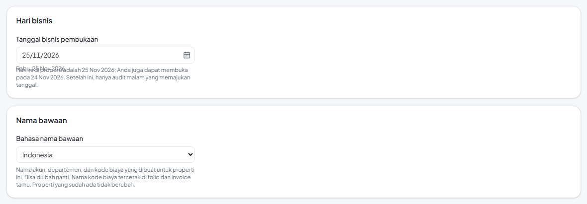
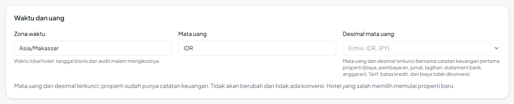

# Properti

**Siapa yang melakukan:** administrator hotel (pengguna dengan centang **Administrator tenant**).
**Kapan dilakukan:** saat hotel baru mulai memakai KamaraPMS, saat perusahaan membuka hotel kedua, atau saat data hotel berubah (alamat, NPWP, jam check-in, catatan kaki dokumen).
**Sebelum mulai:**
- Siapkan nama resmi, alamat, telepon, e-mail, NPWP, dan jam check-in/check-out hotel.
- Tentukan mata uang dan jumlah desimalnya. Untuk rupiah: `IDR` dengan `0` desimal. Pilihan ini terkunci setelah catatan keuangan pertama.

**Properti** adalah satu hotel. Satu perusahaan (tenant) bisa punya beberapa properti, dan setiap properti punya hari bisnis, kamar, tarif, dan pembukuannya sendiri. Urutan setup lengkapnya ada di [Setup awal hotel](../00-memulai/setup-awal-hotel.md).

## Langkah-langkah

### Membuat properti baru

1. Buka **Pengaturan → Properti**. Daftar menampilkan **Kode**, **Nama**, **Kota**, **Zona waktu**, **Mata uang** (misalnya `IDR (0 desimal)`), dan **Status**.

   

2. Klik **Properti baru**, lalu isi kartu **Identitas**.

   | Field | Wajib? | Keterangan |
   |---|---|---|
   | Kode | Ya | Singkat, huruf besar dan angka, misalnya `SANUR`. Tidak bisa diubah setelah disimpan. |
   | Nama | Ya | Nama hotel yang tercetak di dokumen, misalnya `Hotel Kamara Sanur`. |
   | Alamat, Kota | Tidak | Misalnya `Jl. Danau Tamblingan No. 50`, `Denpasar`. |
   | Negara | Tidak | Kode dua huruf, misalnya `ID`. |
   | Telepon, E-mail | Tidak | Dicetak pada faktur, kwitansi, dan konfirmasi. |
   | Nomor registrasi pajak | Tidak | NPWP hotel. Dicetak pada faktur. |
   | Catatan kaki dokumen | Tidak | Kalimat penutup dokumen, misalnya `Terima kasih telah menginap bersama kami`. |

3. Isi kartu **Waktu dan uang**.

   | Field | Wajib? | Keterangan |
   |---|---|---|
   | Zona waktu | Ya | Ketik atau pilih dari daftar. Bali dan Nusa Tenggara: `Asia/Makassar`; Jawa dan Sumatra: `Asia/Jakarta`. Tanggal bisnis dan audit malam mengikutinya. |
   | Mata uang | Ya | Kode tiga huruf, misalnya `IDR`. |
   | Desimal mata uang | Ya | **0 (mis. IDR, JPY)**, **2 (mis. USD, SGD)**, atau **3 (mis. KWD)**. |

4. Isi kartu **Kebijakan**.

   | Field | Wajib? | Keterangan |
   |---|---|---|
   | Jam check-in / Jam check-out | Ya | Bawaan `14:00` dan `12:00`. |
   | Deposit insidental saat check-in | Tidak | Deposit yang diusulkan per kamar saat check-in, di atas perkiraan menginap, misalnya `500000`. `0` berarti tidak mengusulkan apa pun. |
   | Jam paling awal audit malam | Tidak | Hari bisa ditutup mulai jam lokal ini, atau kapan pun setelah tengah malam. Bawaan `20:00`. |
   | Wajibkan kamar sudah diperiksa untuk check-in | Tidak | Kalau dicentang, kamar harus berstatus **Sudah diperiksa**. Kalau tidak, **Bersih** sudah cukup. |
   | Audit malam menandai kamar terisi sebagai kotor | Tidak | Bawaan tercentang: kamar tamu menginap masuk daftar pembersihan setiap hari. |
   | Pelepasan deposit | Ya | **Setiap hari**: deposit dipakai membayar biaya folio setiap tutup hari (bawaan). **Saat folio ditutup**: deposit tetap utuh sampai folio ditutup. |
   | Refund dapat dikeluarkan lewat | Ya | Centang metode yang boleh dipakai front office untuk refund: **Tunai**, **Kartu**, **Transfer bank**, **Lainnya**, **QRIS**. Sisakan minimal satu. |

5. Isi dua kartu yang hanya ada pada properti baru.

   | Field | Wajib? | Keterangan |
   |---|---|---|
   | Tanggal bisnis pembukaan | Ya | Hari pertama properti di KamaraPMS. Hanya bisa hari ini atau kemarin (tertulis di bawah kolom). |
   | Bahasa nama bawaan | Ya | **Indonesia** atau **English**: bahasa nama akun, departemen, dan kode biaya yang dibuat otomatis. Nama kode biaya tercetak di folio dan invoice tamu. |

   

6. Klik **Buat properti**. Anda kembali ke daftar, dan KamaraPMS langsung pindah ke properti baru itu.

### Mengubah properti

7. Di daftar **Properti**, klik kode properti. Judul halaman menjadi **Properti {kode}**.
8. Ubah yang perlu. Di bawah **Waktu dan uang**, kalimat "Mata uang dan desimal terkunci: properti sudah punya catatan keuangan. …" berarti kedua kolom itu tidak bisa diubah lagi. Untuk menghentikan properti, pilih **Status** **Nonaktif**.

   

9. Klik **Simpan perubahan**.

## Hasilnya

- Properti baru punya hari bisnis yang terbuka pada tanggal pembukaan. Setelah itu, hanya audit malam yang memajukan tanggalnya.
- Properti baru langsung mendapat bagan akun, departemen, tipe tempat tidur (King, Queen, Double, Twin, Single), dan kode biaya bawaan seperti **ROOM**, **ROOM_EXEMPT**, **BREAKFAST**, **RESTAURANT**, **LAUNDRY**, dan **MINIBAR**.
- Tidak ada pesan "tersimpan": formulir tertutup dan daftar menampilkan data baru.

## Perlu diperhatikan

> ⚠️ Penting: **Kode**, **Tanggal bisnis pembukaan**, dan **Bahasa nama bawaan** hanya bisa diisi sekali, saat membuat properti. **Mata uang** dan **Desimal mata uang** terkunci begitu ada biaya, pembayaran, jurnal, tagihan, mutasi bank, atau anggaran pertama, dan tidak pernah dikonversi. **Pelepasan deposit** terkunci sejak transaksi pertama. Hotel yang salah memilih harus memulai properti baru.

- **Properti baru belum punya pajak dan service charge.** Pasang sebelum menerima tamu: lihat [Pajak dan kode biaya](pajak-dan-kode-biaya.md).
- **Properti tidak bisa dihapus.** Pilih **Status** **Nonaktif** untuk menghentikannya.
- **"Batas paket tercapai: paket mengizinkan {limit}, dan {used} sedang dipakai."**: langganan hotel sudah penuh untuk jumlah properti. Lihat [Langganan dan sistem](langganan-dan-sistem.md).
- **Pesan dalam bahasa Inggris** di bawah kolom:
  - **Zona waktu**: `an IANA time zone such as Asia/Jakarta` (isi nama zona waktu seperti `Asia/Jakarta`). Pilih dari daftar supaya ejaannya tepat.
  - **Deposit insidental saat check-in**: `more decimals than the property currency has` (desimalnya lebih banyak dari mata uang properti). Untuk rupiah, ketik tanpa desimal.

## Terkait

- [Setup awal hotel](../00-memulai/setup-awal-hotel.md)
- [Memahami tanggal bisnis](../00-memulai/memahami-tanggal-bisnis.md)
- [Tipe kamar dan kamar](tipe-kamar-dan-kamar.md)
