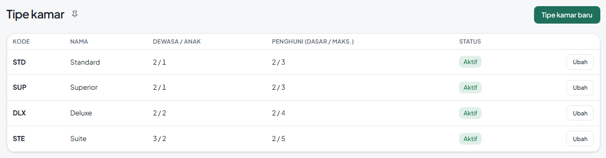
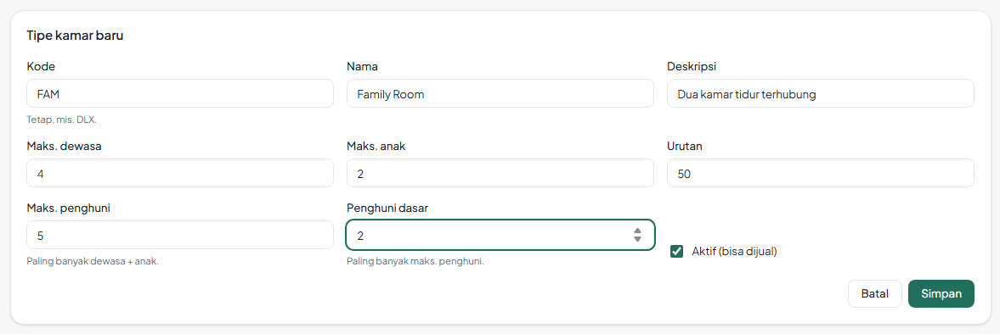
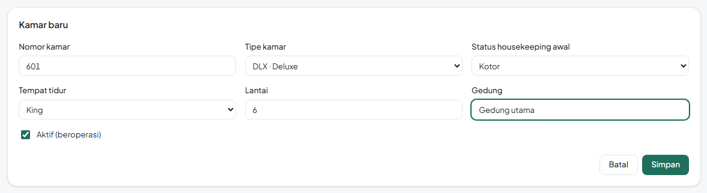

# Tipe kamar dan kamar

**Siapa yang melakukan:** administrator hotel, atau staf yang perannya boleh mengelola tipe kamar dan kamar.
**Kapan dilakukan:** saat setup awal, saat hotel menambah atau merenovasi kamar, dan saat sebuah kamar berhenti dijual untuk waktu lama.
**Sebelum mulai:** daftar tipe kamar (kode, nama, kapasitas) dan daftar nomor kamar dengan tipe, tempat tidur, dan lantainya.

**Tipe kamar** mengelompokkan kamar yang setara, misalnya Deluxe. Ketersediaan dan harga dihitung per tipe. **Kamar** adalah satu nomor kamar fisik, dan setiap kamar punya satu tipe dan satu tipe tempat tidur.

## Langkah-langkah

### Tipe kamar

1. Buka **Pengaturan → Tipe kamar**. Tabel menunjukkan **Kode**, **Nama**, **Dewasa / anak**, **Penghuni (dasar / maks.)**, dan **Status** tiap tipe.

   

2. Klik **Tipe kamar baru**, lalu isi formulirnya.

   | Field | Wajib? | Keterangan |
   |---|---|---|
   | Kode | Ya | Singkat dan tetap, misalnya `FAM`. Tidak bisa diubah setelah disimpan. |
   | Nama | Ya | Misalnya `Family Room`. |
   | Deskripsi | Tidak | Misalnya `Dua kamar tidur terhubung`. |
   | Maks. dewasa / Maks. anak | Ya | Misalnya `4` dan `2`. |
   | Urutan | Tidak | Angka kecil tampil lebih dulu di daftar dan grid. |
   | Maks. penghuni | Ya | Paling banyak dewasa + anak, misalnya `5`. |
   | Penghuni dasar | Ya | Jumlah tamu yang sudah termasuk harga, paling banyak **Maks. penghuni**, misalnya `2`. |
   | Aktif (bisa dijual) | Tidak | Biarkan tercentang. |

   

3. Klik **Simpan**. Tipe baru muncul di tabel. Untuk mengubahnya nanti, klik **Ubah** pada barisnya.

### Tipe tempat tidur

4. Buka **Pengaturan → Tipe tempat tidur**. Properti baru sudah punya **King**, **Queen**, **Double**, **Twin**, dan **Single**. Untuk menambah, klik **Tipe tempat tidur baru**, isi **Kode** (misalnya `SOFA`), **Nama** (misalnya `Sofa bed`), dan **Urutan**, lalu klik **Simpan**. Tamu dapat meminta tipe tempat tidur saat reservasi, tetapi kamar satu tipe tetap dijual bersama.

### Kamar

5. Buka **Pengaturan → Kamar**. Saring daftar dengan **Tipe kamar** kalau kamarnya banyak.
6. Klik **Kamar baru**, lalu isi formulirnya.

   | Field | Wajib? | Keterangan |
   |---|---|---|
   | Nomor kamar | Ya | Nomor di pintu, misalnya `601`. Tidak boleh sama dengan kamar lain. |
   | Tipe kamar | Ya | Misalnya `DLX · Deluxe`. |
   | Status housekeeping awal | Ya | **Kotor** (bawaan), **Bersih**, atau **Sudah diperiksa**. Hanya ada pada kamar baru. |
   | Tempat tidur | Ya | Misalnya **King**. |
   | Lantai | Tidak | Misalnya `6`. |
   | Gedung | Tidak | Misalnya `Gedung utama`. |
   | Aktif (beroperasi) | Tidak | Biarkan tercentang. |

   

7. Klik **Simpan**. Kamar baru muncul di daftar dan langsung bisa dijual.

### Mengubah atau menonaktifkan kamar

8. Klik **Ubah** pada baris kamar, ubah tipe, tempat tidur, lantai, atau gedungnya, atau hapus centang **Aktif (beroperasi)**, lalu klik **Simpan**.

## Hasilnya

- Tipe kamar yang aktif muncul di pencarian reservasi, [Grid tarif](paket-tarif-dan-grid-tarif.md), dan bagan kamar.
- Kamar yang aktif menambah stok tipenya. Status kebersihan kamar selanjutnya diubah oleh housekeeping, bukan di sini.

## Perlu diperhatikan

- **Tipe kamar dan kamar tidak bisa dihapus.** Hapus centang **Aktif** untuk berhenti menjualnya.
- **Tombol Kamar baru** tidak bisa diklik sebelum ada tipe kamar ("Buat tipe kamar sebelum menambah kamar.").
- **Tipe kamar baru belum punya harga.** Isi harganya di [Grid tarif](paket-tarif-dan-grid-tarif.md) sebelum dijual.
- **Pesan saat menonaktifkan atau memindah kamar:**
  - "Tipe kamar ini masih punya kamar aktif atau reservasi mendatang.": nonaktifkan kamarnya dulu, dan pindahkan reservasi mendatang ke tipe lain.
  - "Kamar sedang ditempati atau sudah ditetapkan ke reservasi mendatang.": pindahkan tamunya atau lepaskan kamar dari reservasi itu dulu. Daftar di bawah pesan menyebut tamu menginap atau baris reservasi yang bentrok, dengan tanggalnya.
  - "Perubahan ini membuat tipe kamar terjual melebihi stok pada beberapa malam.": tipe itu sudah dipesan penuh pada malam tertentu, jadi kamarnya tidak bisa dikurangi.
  - "Ada reservasi yang mengunci bed kamar ini." atau "Tidak ada kamar dengan bed ini pada beberapa malam.": ada reservasi yang meminta tempat tidur kamar ini.
- **Kamar yang rusak untuk sementara** jangan dinonaktifkan. Blokir dengan [Blokir kamar OOO/OOS](../02-housekeeping/blokir-kamar-ooo-oos.md).
- **"Batas paket tercapai: …"**: jumlah kamar aktif sudah mencapai batas langganan. Lihat [Langganan dan sistem](langganan-dan-sistem.md).
- **Nama tipe tempat tidur bawaan** berbahasa Inggris (King, Queen, Double, Twin, Single). Ubah namanya dengan **Ubah** kalau perlu; kodenya tetap.
- **Fasilitas kamar** (misalnya pemandangan laut atau bak mandi) belum bisa dicatat.

## Terkait

- [Paket tarif dan grid tarif](paket-tarif-dan-grid-tarif.md)
- [Status kamar](../02-housekeeping/status-kamar.md)
- [Blokir kamar OOO/OOS](../02-housekeeping/blokir-kamar-ooo-oos.md)
