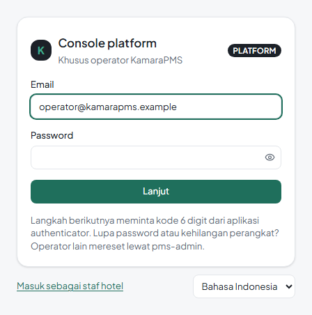

# Console platform

**Siapa yang melakukan:** operator platform, yaitu tim KamaraPMS yang mengelola penyewa (perusahaan hotel), paket, dan invoice langganan. Staf hotel, termasuk administrator hotel, tidak memakai console ini.
**Kapan dilakukan:** saat hotel baru mendaftar, saat hotel memperpanjang atau mengganti paket, saat invoice langganan diterbitkan atau dibayar, dan saat sebuah penyewa harus ditangguhkan.
**Sebelum mulai:**
- Akun operator Anda sudah dibuat oleh operator lain dengan perintah `pms-admin create-operator` di server. Akun operator tidak bisa dibuat dari layar.
- Siapkan ponsel dengan aplikasi authenticator, misalnya Google Authenticator, Microsoft Authenticator, atau 1Password.

Console terpisah dari aplikasi hotel: sesi masuknya sendiri, menunya sendiri (**Penyewa**, **Paket**, **Invoice**), dan tanpa properti atau tanggal bisnis. Operator tidak bisa membuka data hotel ("Console hanya menampilkan kontak. Operator tidak bisa masuk ke data hotel.").

## Langkah-langkah

### Masuk ke console

1. Buka alamat console platform, yaitu alamat KamaraPMS dengan akhiran `/platform`. Halaman **Console platform** ("Khusus operator KamaraPMS") muncul dengan tanda **Platform**.

   

2. Isi **Email** dan **Password** (kata sandi), lalu klik **Lanjut**.
3. **Pertama kali masuk**, layar **Aktifkan aplikasi authenticator** muncul:
   - **Langkah 1**: pindai kode QR dengan aplikasi authenticator. Kalau tidak bisa memindai, klik **Salin** di samping kuncinya dan masukkan kunci itu ke aplikasi.
   - **Langkah 2**: ketik **Kode 6 digit dari aplikasi**, lalu klik **Aktifkan**.
   - Bagian **Kode pemulihan** menampilkan 10 kode. Klik **Unduh .txt** atau **Salin semua**, simpan di tempat aman, centang **Sudah saya simpan**, lalu klik **Masuk ke console**.

   > ⚠️ Penting: kode pemulihan hanya tampil sekali. Setiap kode hanya berlaku sekali, dan dipakai kalau ponsel hilang.

4. **Masuk berikutnya**, layar **Kode authenticator** meminta **Kode 6 digit** dari aplikasi. Ketik kodenya, lalu klik **Masuk**. Kalau ponsel tidak ada, klik **Pakai kode pemulihan**, ketik satu **Kode pemulihan**, lalu klik **Masuk**.

### Penyewa

5. Menu **Penyewa** menampilkan kotak ringkasan (**Aktif**, **Percobaan**, **Masa tenggang**, **Hanya baca**, **Invoice terbuka**) dan daftar semua penyewa. Saring dengan **Cari penyewa**, **Status**, dan **Paket**. Penyewa yang butuh tindakan ada di urutan atas. **Ekspor CSV** mengunduh daftarnya.
6. **Penyewa baru**: klik **+ Penyewa baru**, lalu isi jendelanya.

   | Field | Wajib? | Keterangan |
   |---|---|---|
   | Kode | Ya | Huruf dan angka, misalnya `SGR`. Inilah **kode tenant** yang diketik staf hotel saat masuk. Tidak bisa diubah nanti. |
   | Nama | Ya | Nama perusahaan hotel, misalnya `PT Segara Resort`. |
   | Zona waktu | Ya | Bawaan `Asia/Jakarta`. |
   | E-mail / Nama lengkap (Administrator pertama) | Tidak | Administrator hotel pertama. Kosongkan keduanya untuk membuat penyewa tanpa pengguna. |

   Klik **Buat penyewa**. Muncul "Penyewa dibuat" dengan **Kata sandi administrator**. Klik **Salin** dan berikan kata sandi itu kepada administrator hotel secara pribadi, lalu klik **Buka penyewa**.

   > ⚠️ Penting: kata sandi administrator hanya tampil sekarang dan tidak bisa ditampilkan lagi. Kode penyewa juga tidak bisa diubah.

7. Klik **Buka** pada sebuah penyewa untuk membuka halamannya: kartu **Langganan**, **Kuota & pemakaian**, **Modul dalam paket**, **Invoice**, **Admin penyewa** (dengan login terakhir), dan **Aktivitas langganan**. Kalimat di atas kartu memberi tahu keadaannya, misalnya "Masa percobaan berakhir {tanggal} ({n} hari lagi).".

   <!-- SCREENSHOT: halaman satu penyewa: tombol Ubah langganan / Terbitkan invoice / Tangguhkan, kalimat keadaan, dan kartu Langganan, Kuota & pemakaian, Invoice -->

### Langganan dan invoice

8. **Ubah langganan**: klik **Ubah langganan**. Ubah **Paket**, **Status** (**Aktif** atau **Percobaan**), **Dibayar sampai** (atau centang **Tanpa tanggal berakhir**), **Hari tenggang** (0 sampai 90), dan **Kuota khusus penyewa** untuk **Properti**, **Kamar**, dan **User** (kosong berarti ikut paket). Klik **Simpan**. Tanpa invoice, perubahan langsung berlaku.
9. **Terbitkan invoice**: klik **Terbitkan invoice**. Pilih **Paket ditagih**, isi **Jumlah periode** (1 sampai 36), periksa **Periode (otomatis)** dan **Nomor berikutnya**, ubah **Jumlah** kalau ada diskon, isi **Jatuh tempo** dan **Catatan (opsional)**, lalu klik **Terbitkan**. Untuk naik ke paket berbayar, terbitkan invoice dengan paket baru: paketnya berganti saat invoice dibayar.

   <!-- SCREENSHOT: jendela Terbitkan invoice dengan Periode (otomatis), Nomor berikutnya, dan Jumlah -->

10. **Catat pembayaran**: setelah uang diterima, klik **Catat bayar** pada invoice (atau **Catat pembayaran** di kalimat atas halaman). Isi **Tanggal bayar** dan **Referensi** (misalnya nomor transfer), periksa kotak **Setelah disimpan**, lalu klik **Catat pembayaran**. Langganan langsung diperpanjang, dan banner masa tenggang di hotel hilang.
11. **Void invoice**: untuk invoice yang salah, klik **Void**, isi **Alasan**, lalu klik **Void invoice**.

### Menangguhkan penyewa

12. Klik **Tangguhkan**, isi **Alasan**, ketik kode penyewa di kolom konfirmasi, lalu klik **Tangguhkan**. Semua pengguna penyewa itu langsung keluar dan tidak bisa masuk; datanya tidak dihapus. Untuk memulihkan, klik **Aktifkan kembali**, isi **Alasan**, lalu klik **Aktifkan kembali**.

### Paket

13. Menu **Paket** menampilkan paket yang dijual, dengan harga, kuota, modul, dan masa percobaannya. Klik **+ Paket baru** atau **Ubah** pada sebuah paket.

   | Field | Wajib? | Keterangan |
   |---|---|---|
   | Kode | Ya | 2 sampai 30 karakter: A-Z, 0-9, - atau _. Tidak bisa diubah setelah dibuat. |
   | Nama | Ya | Misalnya `Hotel kecil`. |
   | Harga per periode / Periode tagihan | Ya | Misalnya `1500000` per **1 bulan**, **3 bulan**, **6 bulan**, atau **12 bulan**. |
   | Modul | Tidak | **Inti (front office)** selalu termasuk. Centang **Housekeeping**, **Accounting** (akuntansi), **POS**, **Inventory & aset**, dan **Banquet** yang dijual. |
   | Properti aktif / Kamar aktif / User aktif / Hari percobaan | Ya | Isi angka, atau centang **Tanpa batas** / **Tanpa masa percobaan**. |
   | Dijual | Tidak | Paket yang tidak dijual tetap berlaku bagi penyewanya, tetapi tidak bisa diberikan ke penyewa lain. |
   | Paket bawaan untuk penyewa baru | Tidak | Hanya satu paket yang bisa menjadi bawaan. |

   Klik **Simpan paket**. Muncul "Paket tersimpan.". Kalau kuota diturunkan di bawah pemakaian, layar menyebut penyewa yang kini melewati batas. Tidak ada yang dinonaktifkan; penyewa itu hanya tidak bisa menambah lagi.

### Invoice semua penyewa

14. Menu **Invoice** menampilkan invoice langganan semua penyewa dalam tab **Terbuka**, **Lewat jatuh tempo**, **Dibayar**, dan **Di-void**. Kolom **Jatuh tempo** menyebut misalnya "telat 3 hari" atau "5 hari lagi". **Catat bayar** dan **Void** bekerja seperti di halaman penyewa, dan memunculkan pesan "Invoice {nomor} tercatat dibayar." atau "Invoice {nomor} di-void.".

## Hasilnya

- Penyewa baru bisa langsung masuk dengan kode penyewa dan akun administratornya, lalu membuat properti pertamanya (lihat [Setup awal hotel](../00-memulai/setup-awal-hotel.md)).
- Perubahan langganan, kuota, dan pembayaran terlihat oleh hotel di [Langganan dan sistem](../13-pengaturan/langganan-dan-sistem.md) pada permintaan berikutnya.

## Perlu diperhatikan

> ⚠️ Penting: invoice yang sudah dibayar tidak bisa diubah atau di-void, dan void invoice tidak bisa dibatalkan. Periksa nomor dan jumlahnya sebelum menyimpan.

- **Untuk keterlambatan bayar, jangan menangguhkan.** Biarkan masa tenggang habis: hotel menjadi hanya baca. Tangguhkan hanya untuk penyalahgunaan atau atas permintaan penyewa.
- **Invoice yang periodenya bertumpuk** dengan invoice terbuka lain ditolak. Jendela **Terbitkan invoice** memperingatkannya lebih dulu; catat pembayaran atau void invoice lama dulu.
- **Lupa password atau kehilangan ponsel**: operator lain mereset akun Anda dari server. Password operator tidak bisa diganti sendiri dari layar.
- **Sesi console** terpisah dari sesi hotel dan perlu masuk lagi paling lambat setiap 12 jam.
- **"Terlalu banyak percobaan yang gagal: coba lagi nanti."**: tunggu sebentar sebelum mencoba lagi.
- **Istilah di layar** bercampur: "penyewa" dan "tenant" berarti sama, "User" berarti pengguna, dan nama paket bawaan berbahasa Inggris, misalnya "Trial (all modules)" (percobaan, semua modul).

## Terkait

- [Langganan dan sistem](../13-pengaturan/langganan-dan-sistem.md)
- [Setup awal hotel](../00-memulai/setup-awal-hotel.md)
- [Pengguna](../13-pengaturan/pengguna.md)
